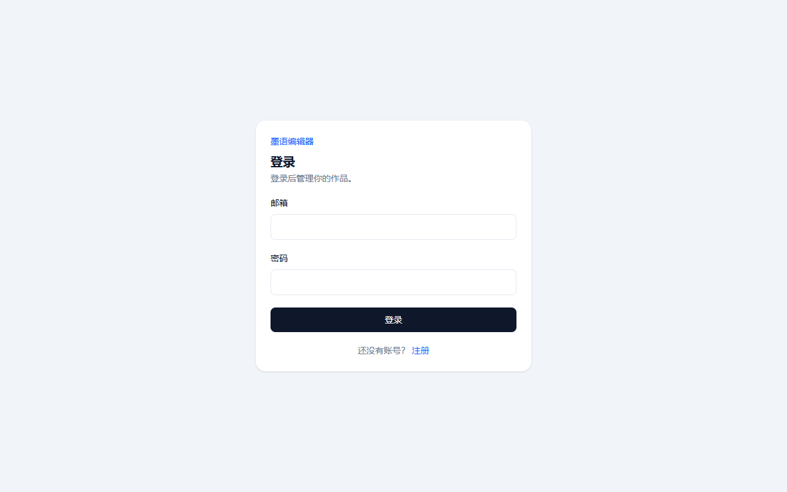
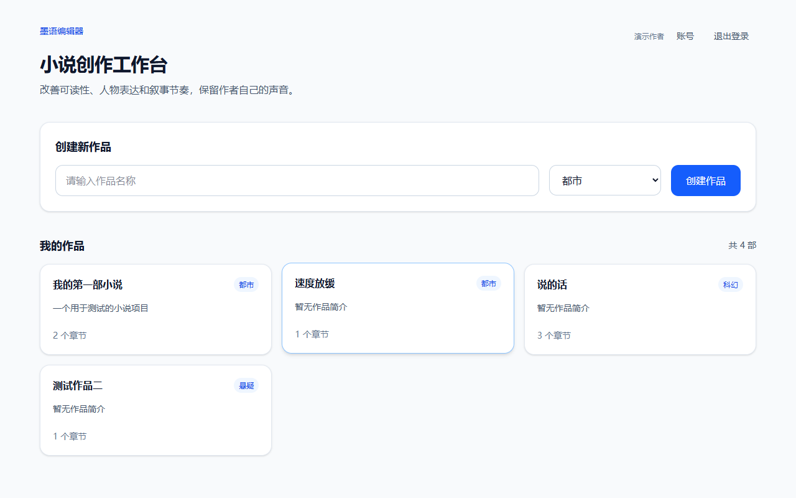
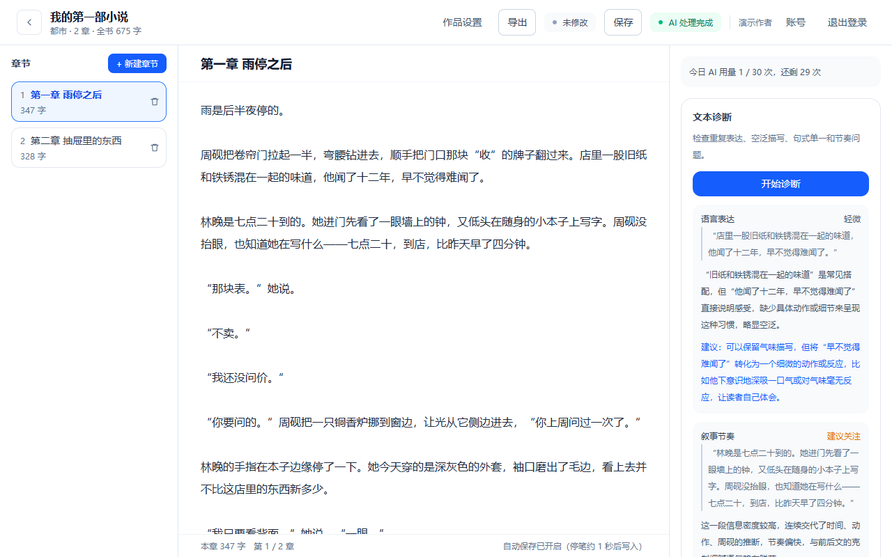
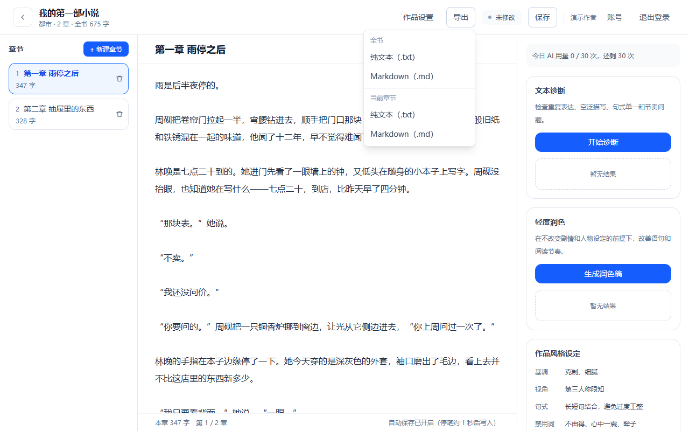

<div align="center">

# 墨语编辑器

**面向中文小说作者的 AI 辅助写作工作台**

写完初稿只是开始。它会告诉你哪里空泛、哪里节奏拖了、哪句对话不像这个人说的。


</div>

> 这是一个完整的产品级项目：数据库、鉴权、AI 接入、自动化测试、运维脚本全部跑通。作者非计算机科班出身，项目在与 AI 协作下完成 —— 需求拆解、技术取舍与验收标准由本人把关。

## 界面

<table>
<tr>
<td width="50%"></td>
<td width="50%"></td>
</tr>
<tr>
<td align="center"><b>登录 / 注册</b></td>
<td align="center"><b>作品列表：多作品管理</b></td>
</tr>
<tr>
<td width="50%"></td>
<td width="50%"></td>
</tr>
<tr>
<td align="center"><b>编辑器 + AI 文本诊断（真实调用结果）</b></td>
<td align="center"><b>全书 / 单章导出</b></td>
</tr>
</table>

## 它能做什么

- **作品与章节管理**：多作品、章节树、实时字数统计
- **写作编辑器**：自动保存（停笔约 1 秒）、未保存状态提示、并发保存乐观锁
- **AI 文本诊断**：检查重复表达、空泛描写、句式单一、叙事节奏，指出具体原文并给出修改建议
- **轻度润色**：不改剧情、不改人设，只调整句子和信息节奏，保留作者自己的声音
- **作品风格档案**：基调 / 视角 / 句式 / 禁用词，作为喂给 AI 的写作约束
- **版本历史**：每次保存留档，可预览并回滚到任一历史版本
- **多格式导出**：全书或单章，txt / md 四路导出
- **账号体系**：注册 / 登录 / 改昵称 / 改密码 / 注销，作品归属校验（改 URL 也进不去别人的作品）
- **额度与限流**：每日 AI 用量计数、接口限流、长度校验
- **工程化**：健康检查、上线前自检、数据库备份与恢复演练、四条运维命令

## 技术栈

| 层 | 选型 |
|---|---|
| 前端 / 服务端 | Next.js 16（App Router）+ React 18 + TypeScript |
| 数据库 | Prisma + SQLite（单机友好，可换 Postgres） |
| AI | DeepSeek API，仅在服务端调用，密钥不下发浏览器 |
| 认证 | 邮箱 + 密码（bcrypt 哈希），会话签名 |
| 测试 | Vitest —— 单元测试 88 项、接口测试 81 项 |

## 快速开始

    npm install
    cp .env.example .env          # 按注释填 AI_API_KEY 与 AUTH_SECRET
    npx prisma migrate dev        # 建库
    npm run app                   # 构建并启动，访问 http://localhost:3001

Windows 用户可以双击项目里的 start-moyu.bat，它会自动启动并打开浏览器。

> 没有 AI 密钥也能跑：除诊断和润色外的功能全部可用。

## 文档

docs 目录下有 20 份文档，覆盖 API 接口说明、部署说明、备份与恢复、运维手册、数据库维护、已知问题、发布记录等。

---

## 〇、先做这一步：注册一个自己的账号

**现在打开首页会自动跳到登录页，这是对的，不是坏了。**

第一次用，点登录页下面的「注册」：

1. 填昵称、邮箱、密码（密码至少 8 位，要输两遍防手滑）
2. 点「注册并登录」→ 自动登录并进入首页
3. 从这里开始，你看到的作品都是**你自己账号下的**，别人看不到

已经有账号就走左边的登录页。右上角随时能「退出登录」。

> 演示数据挂在演示账号下，正式部署前请删除演示账号与示例数据。

---

## 一、怎么启动（照抄即可）

### 最省事：双击 `start-moyu.bat`

项目目录里有个 `start-moyu.bat`，**双击它就行**：

- 服务没启动 → 它自动启动，6 秒后自动帮你打开浏览器
- 服务已经在跑 → 它不重复启动，直接帮你打开浏览器
- 弹出的黑窗口**不要关**，关了服务就停（用完再关）

### 或者手动（PowerShell）

打开 PowerShell，**两行**：

```powershell
cd "（项目根目录）"
npm run app
```

然后浏览器打开：**http://localhost:3001**

> **为什么用 `npm run app` 而不是 `npm run dev`？**
> 本机环境下 Next 开发模式的 HMR（热更新）WebSocket 连不上，会导致浏览器里页面
> 一直停在「正在载入作品…」，看起来像坏了。`npm run app` 走的是生产模式（先构建再启动），
> 没有这个问题，而且更快更稳。**改完代码后需要重新跑一次 `npm run app`。**
>
> **为什么端口是 3001？**
> 3000 被本机另一个程序长期占用，用 3000 会报 `EADDRINUSE` 起不来。

---

## 二、常用命令

| 想干的事 | 命令 |
|---|---|
| **启动（日常用这个）** | `npm run app` |
| 只构建不启动 | `npm run build` |
| 开发模式（热更新，本机可能有 HMR 问题） | `npm run dev -- --port 3001` |
| **单元测试**（不需要起服务） | `npm test` |
| **接口测试**（自动起测试库和服务，跑完自动收摊） | `npm run test:api` |
| **备份恢复演练** | `npm run db:restore-drill` |
| 只做类型检查 | `npm run typecheck` |
| **上线前自检** | `npm run preflight` |
| **备份数据库** | `npm run db:backup` |
| **日常巡检**（应用/登录/保存/AI/数据库，应用没开不算故障） | `npm run ops:daily` |
| **数据库体检**（完整性/容量/索引/孤立数据/迁移/备份） | `npm run ops:db` |
| **AI 用量报表**（次数/耗时/失败率/费用估算，`-- --days=30` 看一个月） | `npm run ops:ai` |
| **发布流水线**（五连检查 + 迁移 + 自动备份 + 部署九步清单） | `npm run ops:release` |
| 把演示账号的作品转给自己 | `npm run works:move -- 你的邮箱@example.com` |
| 重新灌演示数据 | `npm run db:seed` |
| 改完表结构后同步数据库 | `npm run db:migrate` |
| 用网页看数据库内容 | `npm run db:studio` |

---

## 三、第三阶段做了什么（AI 诊断 + 润色）

### 第一步：填 Key（只做一次）

打开 `moyu-editor\.env`，把 Key 填进引号里存盘：

```env
AI_API_KEY="sk-你的DeepSeek Key"
AI_BASE_URL="https://api.deepseek.com"
AI_MODEL="deepseek-chat"
```

然后**重启服务**（`.env` 只在服务启动时读一次）：关掉正在跑的命令窗口 → 重新 `npm run app`。

> Key 只写在服务器端，浏览器里看不到它。这个文件已被 git 忽略，不会进 GitHub。

### 然后是三个按钮的事

1. **文本诊断** —— 点「开始诊断」，右侧列出问题（最多 8 条），每条含：问题类型、
   原文片段、为什么是问题、修改方向、严重度（重要 / 建议关注 / 轻微）。只报告问题，不动正文。
2. **轻度润色** —— 点「生成润色稿」，右侧「润色结果」卡片里给出完整修改稿 + 最多 6 条修改说明，
   并显示字数变化。
3. **接受 / 拒绝** ——
   - 点 **拒绝**：正文一个字都不会变，卡片收起。
   - 点 **接受修改**：正文立即被替换，并马上落库（不等 1.2 秒的防抖）。

原文就在中间的编辑区里，跟右侧的修改稿对照着看，决定要不要用。

### AI 的规矩（写在 system prompt 里，防止它乱改）

- 尊重作者原意，不擅自改剧情事实，不新增人物/事件/设定
- 不把文字改得过度工整、模板化；保留人物说话方式和叙事视角
- 原文已经自然就不硬改；只报告有实际帮助的问题
- 不讨论、不承诺绕过任何 AI 检测

### 单次上限

一次最多处理 **50000 字**（硬上限 100000 个字符，含空白的也算），超了会提示分章处理。
两个上限都在服务端校验，客户端只是提前拦一下、给个提示。输出上限默认 8000 token
（DeepSeek 硬上限 8192），想调可以在 `.env` 里加 `AI_MAX_TOKENS`。

### 出错时会看到什么

| 提示 | 意思 |
|---|---|
| `AI 服务尚未配置，请联系管理员…` | `.env` 里的 Key / 模型名是空的，或者改了没重启 |
| `AI 服务请求失败（4xx/5xx）` | Key 无效、没余额、网络/代理不通 |
| `AI 返回格式无法解析，请重试` | 模型没按 JSON 回（接口已经处理了常见的 Markdown 代码块包裹），重试即可 |
| `AI 请求过于频繁，请 N 秒后再试` | 一分钟内调太多次了，等一会儿 |
| `登录状态已失效，请重新登录` | 会话过期，会自动跳回登录页 |
| `请先输入一些正文内容` | 当前章节是空的 |
| `单次 AI 编辑最多处理 50000 字…` | 太长了，分章或分段处理 |

服务端的详细报错在启动命令的窗口里，或仓库外的 `moyu-server.log`。

---

## 四、第四阶段做了什么（版本历史与回滚）

### 怎么用

1. 正常打字，**每次自动保存都会自动留一个版本**（不用手动点保存）
2. 右侧「版本历史」列出最近 30 个版本，显示时间、来源、当时字数
3. 点任意一条 → 下方弹出「历史版本预览」，可以看当时写了什么
4. 觉得还是旧的好 → 点「恢复此版本」→ 确认 → 正文回到那一版

### 两个要点

- **恢复本身也会记一条新版本**（来源写「从历史版本恢复」）。所以恢复不是"撤销"，
  历史是只增不减的，恢复错了还能再恢复回去。
- **恢复后不会立刻又冒出一条重复版本**：恢复接口已经替这次改动留了档，
  前端会把本地"已保存"标记同步过去，避免防抖保存再发一次请求。

### 版本记录会不会太多

会。连续打字时每停笔一次就是一个版本，所以列表只显示最近 30 条。
**注意：现在数据库里是全部保留的，只是界面不显示。**
下一步可以加「保存间隔限制」和「版本清理策略」（见第十六节）。

保留原有自动保存逻辑不变：停笔 1.2 秒写库、切章前强制落盘、关页面前兜底。

---

## 五、第五阶段做了什么（作品设置与风格档案）

### 怎么用

1. 打开一部作品，点右上角 **「作品设置」**
2. 上半页改 **作品名称 / 作品简介 / 类型**
3. 下半页改 **风格档案**：语气、叙事视角、句式风格
4. 点 **「保存设置」**，看到绿字「设置已保存」就是成功了
5. 点左上角 **「返回编辑器」**，顶部作品名和右栏「作品风格设定」会立刻变成新值

右栏「作品风格设定」下面也加了一个 **「去作品设置里改 →」** 的直达链接。

### 风格档案改了有什么用

AI 诊断和润色时，会把这六项一起发过去当上下文：

| 字段 | 例子 |
|---|---|
| 作品名 | 我的第一部小说 |
| 类型 | 都市 |
| 简介 | 一句话说清这故事讲什么 |
| 语气 | 克制、细腻 |
| 叙事视角 | 第三人称限知 |
| 句式风格 | 长短句结合，避免过度工整 |

想验证有没有真的生效：填好设置 → 回到编辑器 → 点「生成润色稿」，
AI 就是按新的风格要求改的。

### 三处说明

- **禁用词（不由得、心中一震、眸子）现在还不能在界面上改。** 这一版设置页只管
  语气 / 视角 / 句式三个字段，禁用词是原样保留的，不会被清空，等后面的阶段开放编辑。
- **保存设置不会碰到正文。** 设置和章节正文是两套数据，互不影响。
- **在编辑区打字后立刻点「作品设置」也不会丢字。** 跳页前会先把没保存的正文落盘
  （上一阶段发现的坑，这一阶段一并堵上了）。

---

## 六、第六阶段做了什么（登录与权限）

### 一句话

从「谁打开这个网址都能读、能改你的作品」变成「只有你自己能进」。

### 怎么用

- 注册 / 登录 / 退出 —— 见开头的「〇、先做这一步」
- 右上角显示当前登录的账号，点「退出登录」回到登录页

### 权限是怎么拦的

**两层，缺一不可**：

| 层 | 拦什么 | 你会看到什么 |
|---|---|---|
| 页面层 | 直接在地址栏敲别人的作品地址 | 「无权访问该作品」的整页提示，不是白屏、也不是报错 |
| 接口层 | 绕过页面直接调接口 | 403；没登录是 401 |

三种情况分得很清楚：

- **作品不存在** → 「作品不存在」
- **作品存在，但不是你的** → 「无权访问该作品」
- **没登录** → 页面踢回登录页，接口返回 401

被拦住的接口：作品列表、作品详情、新建作品、新建章节、章节读 / 存 / 删、
版本历史列表、版本回滚、作品设置、AI 诊断与润色。

> **AI 接口也必须登录。** 不然任何人拿到这个地址，就能烧你的 API 额度。

### 密码是怎么存的

数据库里**不存明文密码**，存的是 bcrypt 哈希（12 轮，故意算得慢，破解成本高）。
登录失败时只回「邮箱或密码错误」，不告诉你到底是邮箱错还是密码错。

### 退出登录前不会丢字

「退出登录」和「作品设置」都是跳转。跳转前会先把还没落盘的正文强制存一次
——不然刚打完字（1.2 秒防抖还没到）就点退出，那几个字就没了。

### 上线前必做

1. `.env` 里的 `AUTH_SECRET` 换成你自己生成的（生成命令在 `.env.example` 里）
2. 删掉或改掉演示账号 `demo@moyu.local`（作品先用 `npm run works:move -- 你的邮箱` 搬走）
3. 接口归属校验已经全部加上了，但放到公网前，先跑一次 `npm run preflight`

### 部署顺序（照着走）

```bash
npm ci                        # 装依赖（lock 文件里是什么就装什么）
npx prisma migrate deploy     # 应用数据库迁移（不是 migrate dev！dev 会想改表）
npm run build                 # 构建
npm run preflight             # 自检：退出码非 0 就别上线
npm start                     # 启动（本机是 npm run app）
```

注意三点：

- **`migrate deploy` 不是 `migrate dev`**：线上绝对不能用 dev 版，它会在漂移时想重置数据库
- **环境变量配在平台上，不是传 `.env` 文件上去**
- **上线后逐页点一遍**：`/login` → 注册 → 首页 → 打开作品 → 改字等自动保存 → 看历史版本 →
  点一次诊断 → 退出登录 → 直接开 `/api/health` 看 `status` 是不是 `ok`

### 备份与恢复

```bash
npm run db:backup     # 备份到 backups/moyu-YYYYMMDD-HHMMSS.db
```

恢复：**先停服务** → 把备份文件复制回 `prisma/dev.db` → 删掉 `prisma/dev.db-wal` 和
`prisma/dev.db-shm`（如果有）→ 重启 → 随便打开一个作品看正文对不对。

> 换 Postgres 之后，备份直接用它自己的 `pg_dump`，这个脚本就不再需要了。

---

## 七、第七阶段做了什么（AI 能力收口 + 安全加固）

### 一句话

把调 AI 这件事从「接口里随手 fetch」收成一个统一的服务层，
并且给它装上四道闸：**要登录、限次数、限长度、只认自己的章节**。

### 怎么用

**你用起来和以前一样**：编辑器右侧点「开始诊断」或「生成润色稿」。
变的是背后的规矩，以及出错时你会看到一句人话。

### 一、AI 调用统一收口到 `src/lib/ai.ts`

以前请求 AI 的地址、请求体、JSON 解析、错误码全写在接口文件里，
换个模型服务商就得动接口。现在：

| 文件 | 职责 |
|---|---|
| `src/lib/ai.ts` | **所有**跟 AI 服务商打交道的事：提示词、请求、解析、错误码 |
| `src/app/api/ai/edit/route.ts` | 只管四件事：鉴权 → 限流 → 校参 → 把结果转成响应 |
| `src/lib/rate-limit.ts` | 请求频率限制 |
| `src/lib/ai-limits.ts` | 长度上限常量，前后端共用一份 |

要换服务商（比如换成通义、Kimi、本地 Ollama），**只需要改 `ai.ts` 里的 `callProvider` 一个函数**，
接口和页面都不用动。

> `ai.ts` 顶部有一道护栏：一旦被客户端组件 import，浏览器里会立刻抛错。
> 这是防止哪天不小心把带 Key 的模块打进前端包。

### 二、四道闸

| 闸 | 规则 | 被拦时 |
|---|---|---|
| 登录 | 必须登录才能调 AI | 401 `请先登录` |
| 频率 | 每人每分钟 10 次 | 429 `AI 请求过于频繁，请 N 秒后再试`（带 `Retry-After` 头） |
| 长度 | ≤ 100000 字符，且 ≤ 50000 字（去空白） | 400，提示当前多少字 |
| 归属 | 章节必须挂在你自己的作品下 | 403 无权 / 404 章节不存在 |

**为什么长度要卡两次**：只卡字符数的话，有人塞 10 万个空格就绕过去了，
所以还要按「去掉空白后的字数」再卡一次。

**为什么风格档案从数据库读**：以前是前端把作品名、语气、视角一起打包传给接口，
那份数据是可以伪造的。现在接口只收 `projectId + chapterId + 正文`，
风格档案服务端自己去数据库查 —— 顺便还少传了一坨数据。

### 三、错误统一翻译

`ai.ts` 里定义了一个 `AiError`，四种错误码各自对应一个 HTTP 状态和一句中文提示：

| 错误码 | 状态 | 用户看到 |
|---|---|---|
| `AI_NOT_CONFIGURED` | 503 | AI 服务尚未配置… |
| `AI_PROVIDER_ERROR` | 502 | AI 服务请求失败（上游状态码）… |
| `AI_EMPTY_RESPONSE` | 502 | AI 没有返回有效内容，请重试 |
| `AI_INVALID_FORMAT` | 502 | AI 返回格式无法解析，请重试 |

**响应里永远不含 API Key、不含原始堆栈。**

### 四、Key 到底藏在哪

- 只有 `src/lib/ai.ts` 读 `process.env.AI_API_KEY`，而且它只被服务端接口 import
- 项目里**没有也不需要** `NEXT_PUBLIC_AI_API_KEY` 这种东西
- 验证过：浏览器实际加载的 16 个 JS 文件 + 页面 HTML 里，搜不到 Key 明文，
  连 `AI_API_KEY` 这个变量名都搜不到

### 五、注意（多实例部署）

`rate-limit.ts` 是**进程内内存**计数，只适合单机 / 单实例。
以后真上了负载均衡或者 Serverless，每个实例各记各的，限流就形同虚设，
那时必须换成 Redis 之类的共享存储。代码里已经写了注释。

---

## 八、第八阶段做了什么（上线前加固）

### 一句话

把「能跑」变成「敢上线、出事了知道怎么办」：加了健康检查、上线前自检、数据库备份、
启动自检、中文错误页，顺手把一直红的 lint 清干净了。

### 新加的三条命令

| 想干的事 | 命令 |
|---|---|
| **上线前自检**（改完代码、要部署前跑一次） | `npm run preflight` |
| 备份数据库（带时间戳，存 `backups/`） | `npm run db:backup` |
| 把演示账号名下的作品转给另一个账号 | `npm run works:move -- 你的邮箱@example.com` |

自检最后会打印「通过 N ｜ 提醒 N ｜ 必须处理 N」。
**有「必须处理」时退出码不是 0**，所以可以直接塞进自动部署流程里当闸门。

### 健康检查接口 `/api/health`

这是**唯一不需要登录**的接口（外面那层监控探针得能调它）。返回长这样：

```json
{ "status": "ok", "database": "ok", "aiConfigured": true,
  "env": { "nodeEnv": "production", "databaseKind": "sqlite" }, "issues": [] }
```

- 数据库连不上 → **503**，`database` 变成 `error`（这样负载均衡不会把流量发给坏实例）
- 带 `Cache-Control: no-store`，避免健康状态被缓存成「假健康」
- 响应里**不含**连接串、密钥、用户数据、上游原始报错

### 出错时不再给用户看白屏

多了三个兜底页：`error.tsx`（某个页面出错）、`global-error.tsx`（整站级出错）、
`not-found.tsx`（路径不存在）。统一中文提示 + 「重试」按钮，**不显示报错堆栈**。

### 启动时自己体检一次

`src/instrumentation.ts` 会在服务启动时检查关键环境变量（`AUTH_SECRET`、`AI_API_KEY` 等）
在不在、够不够长，缺了就在日志里醒目提示。**只说「有没有」，不打印值。**

### 顺手还的债

`npm run lint` 之前是 **5 个 error + 4 个警告**（渲染期给 ref 赋值、effect 里同步 setState），
现在**零问题**。改动只在 `editor-client.tsx` / `home-client.tsx`，功能行为没变。

### （可选）先把演示作品搬到自己账号再删演示账号

注册好自己的账号后：

```bash
npm run works:move -- 你的邮箱@example.com
```

作品连章节、版本记录一起转过去，转完就能安心删掉 `demo@moyu.local`，作品不会变孤儿。

---

## 九、第九阶段做了什么（稳定性、测试与监控）

### 一句话

给「上线之后」做准备：能自动测、出问题能查、花钱有数、数据丢了能恢复。

### 四条新命令

```bash
npm test              # 单元测试（不需要启动网站，任何时候都能跑）
npm run test:api      # 接口测试（脚本自动起测试库+假 AI+被测服务，跑完自动收摊）
npm run db:restore-drill   # 备份恢复演练（造数据→备份→在另一个库恢复→逐项核对）
npm run typecheck     # 只做类型检查
```

`npm run test:api` 需要先 `npm run build`（它打的是构建后真实运行的服务，不是内存里调函数）。

### 一、自动化测试覆盖了什么

单元测试 48 项（`npm test`），盯的是那些「算错了不会报错、但会一直错下去」的地方：

| 测什么 | 为什么值得测 |
| --- | --- |
| 字数统计 | 前端角标和后端存库共用，口径不一致就会出现「界面 3 万字、库里 2.9 万字」 |
| 限流窗口 | 边界算错就是「明明该放行却拒了」，用户只看到「AI 用不了」 |
| 环境变量体检 | 它的输出会进日志和 `/api/health`，绝不能把密钥值带出去 |
| AI 错误翻译 | 用户看到的每一句 AI 报错都从这里出，不能夹带上游原始报文 |
| 错误日志 | 只记白名单字段，密码/Cookie/Key/正文塞进来必须被丢掉 |
| AI 用量与额度 | 以及「记账失败不许把已经生成好的润色稿弄丢」 |

接口测试（`npm run test:api`）打真实 HTTP，覆盖：

- **账户**：注册（含重复注册 409、弱密码 400）、正确/错误密码登录、退出、未登录访问受保护接口一律 401
- **作品**：创建、读取、修改、删除、级联删除，以及乙访问甲的作品一律 403 / 不存在的 id 404
- **章节**：新建、保存（字数与版本号）、版本历史、回滚、并发冲突 409
- **AI**：诊断、润色、空内容 400、超长 400、越权 403、每分钟限流 429、每日额度 429、上游 500/401/空/非 JSON 全部 502

接口测试打的是一个**连测试库的独立实例**（`prisma/test.db`，端口 3002），
不会污染你正在用的作品。它连的 AI 是脚本里的假服务（`scripts/fake-ai-server.mjs`），
所以「上游挂了会怎样」这种平时复现不了的情况，这里能稳定测出来，而且不花钱。

### 二、AI 用量与每日额度（新）

`AiUsage` 表记每一次**成功**的调用：谁、哪部作品、哪一章、什么模式、输入输出各多少字符。

- 面板右上角会显示「今日 AI 用量 x / 30 次」，剩 0 次时两个 AI 按钮自动变灰
- 额度按自然日算（服务器本地时间 0 点恢复）
- **失败的调用不记账**：上游挂了不该扣你的次数
- **记账失败不影响 AI 结果**：账可以记漏，但已经生成好的润色稿必须给你

额度数字只在一个地方定义：`src/lib/ai-usage.ts` 的 `DAILY_AI_LIMIT`。
要改成 50 次/天，就改这一个数字。

### 三、并发保存不再互相覆盖（新）

场景：同一章在两个标签页（或手机+电脑）里都打开了，右边先保存，左边再保存 ——
以前左边会把右边刚写的字覆盖掉。

现在每个章节有一个版本号（`Chapter.version`），保存时前端带上一句
「我看到的版本是这个」，服务端发现对不上就直接 **409 拒绝**，绝不覆盖。这时编辑器顶上会出现一条黄条，两个选择：

- **刷新取最新版**：放弃本地改动，载入服务端最新的（会明确告诉你放弃了什么）
- **用我的内容覆盖**：保留你正在打的内容，覆盖服务端那一版（对方那次改动仍在版本历史里，能回滚）

冲突没解决之前**自动保存会暂停**，你打的字一个字都不会丢；切换章节也会被拦住，
免得切过去把没保存的内容冲掉。

### 四、安全响应头（新）

`next.config.ts` 里加了五个头：禁止猜类型（`nosniff`）、禁止被塞进 iframe
（`X-Frame-Options: DENY`，防点击劫持）、跨站跳转不带具体路径、关掉摄像头/麦克风/定位权限、关掉 DNS 预取。

**没有上严格的 CSP**，这是核查后的决定，原因写在 `next.config.ts` 的注释里：
严格 CSP 要求给 Next.js 注入的内联脚本发 nonce，而 nonce 会强制整站动态渲染
（首页的静态化就白做了）；自动保存的 `connect-src` 在反向代理子路径下很容易写错，
症状是「保存一直失败但控制台没明显报错」，排查成本极高；而 AI Key 本来就只在服务端，
CSP 对它没有任何额外保护作用。真要上，第一步应该是 `Content-Security-Policy-Report-Only`
观察一周真实拦截情况，而不是直接上强制版。

### 五、错误编号（新）

日志和错误响应里现在带编号，报错时截图就能定位：

| 编号 | 什么情况 |
| --- | --- |
| `AUTH_FAILED` | 未登录 / 会话过期 |
| `PROJECT_ACCESS_DENIED` | 作品或章节不属于你（403） |
| `VALIDATION_FAILED` | 参数不合法（400） |
| `RATE_LIMITED` | 一分钟内超过 10 次（429） |
| `DAILY_QUOTA_EXCEEDED` | 今日 30 次用完了（429） |
| `VERSION_CONFLICT` | 内容已被别处更新（409） |
| `AI_PROVIDER_ERROR` | AI 上游报错（502） |
| `DATABASE_ERROR` | 数据库相关故障 |

日志里只记「谁的、哪儿的、什么错」（用户 id、作品 id、章节 id、模式、耗时），
**不记**密码、Cookie、Authorization、API Key、正文全文、数据库连接串。
原来那些 `console.error(error)` 已经全部换掉 —— 那个写法会把整个异常对象连堆栈丢进日志，
而 Prisma 的初始化异常里是带连接串的。

### 六、数据库索引（新）

`Project(userId, updatedAt)`、`Chapter(projectId, updatedAt)`、`Revision(chapterId, createdAt)`
—— 正好对应首页列表、章节列表、版本历史这三条最常跑的查询。
线上执行 `npm run db:deploy`（= `prisma migrate deploy`）应用。

### 七、上线后 24 小时盯这些

| 看什么 | 在哪儿看 | 什么算不正常 |
| --- | --- | --- |
| 登录失败率 | 日志里搜 `LOGIN_FAILED` | 突然成片出现 = 可能被撞库，或 `AUTH_SECRET` 被改过 |
| 数据库错误 | 搜 `DATABASE_ERROR` | 出现 P1001/P1008 = 连接池或数据库挂了 |
| AI 失败率 | 搜 `AI_PROVIDER_ERROR` | 集中 401 = Key 失效；集中 429 = 上游限流 |
| AI 平均响应时间 | 日志里的 `durationMs` | 明显变慢 = 上游拥堵或正文太长 |
| 限流次数 | 搜 `RATE_LIMITED` | 某个人反复出现 = 有人在刷 |
| 500 错误 | 搜 `UNKNOWN_ERROR` | 任何一条都要当天看 |
| AI 花费 | 服务商后台 + `AiUsage` 表 | 突然翻倍 = 有人在薅 |
| 页面打不开 | 对 `/api/health` 做外部拨测 | 返回 503 = 数据库或环境变量有问题 |

出事的处理顺序：**先降级**（临时把 `DAILY_AI_LIMIT` 调小或摘掉 AI Key，AI 接口会返回 503
但网站照常能用）→ 查数据库连接 → 看最近一次改了什么 → 回滚到上一个版本 → 查异常请求。

### 八、备份恢复演练（新）

`npm run db:restore-drill` 会走完一整轮：造一份演练数据 → WAL 落盘 → 备份 →
在**另一个库文件**里恢复（绝不动你正在用的 `prisma/dev.db`）→ 核对用户/作品/章节/版本
的数量与关系链 → 用 bcrypt 重新验一次密码（确认恢复后登得上）→ 删干净演练数据。

---

## 十、第十阶段做了什么（最终验收与发布准备）

### 一句话

把「能用」验成「敢给陌生人用」：账号自己的事能自己改、东西能自己删、
列表不再一次拉全、手机上也点得着，最后全部跑一遍端到端验收，
并把文档、发布记录、回滚方案补齐。

> 完整报告：`_p10/第十阶段-验收报告.txt`（含 16 项发布清单逐条核对）

### 一、账号页 `/account`（新）

右上角点自己的名字 → 账号设置，三件事：

| 能干什么 | 规矩 |
|---|---|
| 改昵称 | 1~50 字，改完立刻生效 |
| 改密码 | 要输旧密码；改完**所有设备（含当前这台）立刻退出登录**，要用新密码重登 |
| 注销账号 | 要输密码；作品、章节、版本历史、人物卡、风格档案、AI 用量全部一起删掉，**无法恢复** |

「改密码后所有设备掉线」是故意的（`User.tokenVersion` 会话代次机制）——
密码被人知道了、或者怀疑账号被动过，改一次就能把别人踢下去。

### 二、删除入口补齐

| 删什么 | 在哪 | 怎么防手滑 |
|---|---|---|
| 删作品 | 作品设置页 → 「危险区」 | 必须**手动把作品名一个字一个字打对**才解锁删除按钮 |
| 删章节 | 编辑页章节列表，每条后面的删除按钮 | 弹确认框，并告知「该章的版本历史也会一起删」 |

删章节之后**序号自动补齐**，不会出现「第 1 章 / 第 3 章 / 第 5 章」这种断号。
删完会顺手把空档填上，省得你以后排序时看着别扭。

三处删除都明明白白写了**「无法恢复」**，没有含糊说法。

### 三、列表改成分页

以前是「有多少拉多少」，作品多了首页会越来越慢。现在：

- 首页首屏拉 24 部，到底了有「加载更多」
- **版本历史列表只回摘要**（时间 / 来源 / 字数），点开某一条才去取那一版的全文
- 靠的是第 9 阶段加的 `Revision.chars` 字段 —— 列表查询完全不读正文列

实测版本历史列表的响应体只有 490 字节（4 条记录），接口耗时 9ms。

### 四、编辑器状态补全

状态灯现在能覆盖这些情况，**不再只有「已保存」一种**：

```
未修改 → 有改动待保存 → 保存中… → 已保存 21:23:16
                      ↘ 保存失败，请检查网络
恢复中…  ｜  AI 处理中 → AI 处理完成
```

润色结果面板上多了四个按钮，**AI 结果永远不会自动盖掉你的正文**：

| 按钮 | 干什么 |
|---|---|
| **采用结果** | 写进正文并立刻落库（不等 1.2 秒防抖） |
| **替换当前内容** | 只换编辑器里的字，**先不落库**，你可以接着改 |
| **复制结果** | 复制到剪贴板（浏览器不给权限时会明确告诉你，不是点了没反应） |
| **放弃结果** | 面板收起，正文一个字不动 |

结果面板上明确标着「待确认」三个字。
**等待 AI 期间如果你改了正文、或者切了章，会明确提示甚至作废这次结果** ——
免得你辛苦打的字被一个几分钟前的 AI 稿子盖掉。

### 五、手机与无障碍

- 五种屏幕都测过（手机竖屏 / 手机横屏 / 平板 / 桌面 / 320px 窄屏），
  **横向撑破 0 像素**，顶栏按钮不再被挤到点不着
- 状态提示加了 `role="status"` + `aria-live`，读屏软件能播报「保存中 / 已保存 / 保存失败」
- 纯图标按钮都带 `aria-label`，读屏能念出用途
- 错误提示**不只靠颜色**，一律带 ⚠ 前缀和明确文字
- 正文对比度实测 18:1 以上（无障碍标准要求 4.5:1）

### 六、验收结果（331 项全绿）

| 验收 | 结果 |
|---|---|
| 接口层全流程 + 越权 + 隐私 + 输入安全 + 数据残留 | **96 / 96** |
| 接口回归测试 `npm run test:api` | **70 / 70** |
| 单元测试 `npm test` | **48 / 48** |
| 真浏览器端到端 `_p10/ui-flow.mjs` | **117 / 117** |

真浏览器那一轮是**真的开了个浏览器**点下来的：注册 → 登录 → 建作品 → 改设置 →
建章 → 打字 → 看自动保存状态灯 → 手动保存 → Ctrl+S → 打一半就切章 → 刷新 →
看版本历史 → 恢复版本 → AI 诊断 → AI 润色 → 拔网线看报错 → 换账号试越权 → 换五种屏幕尺寸。

用第二个账号试了 10 个攻击面（读作品 / 读章节 / 改内容 / 删东西 / 改设置 / 调 AI /
看历史 / 回滚），**全部 403 或 404，一个字的真实内容都没漏**。

### 七、发布信息

- 版本号：`1.0.0-rc.1`
- 数据库迁移：**本次没有新增**（第 9 阶段的三个已经在里面了）
- 回滚方式：退回上一个 commit + 重建 + 重启，**数据库不用动**

---

## 十一、第十一阶段做了什么（正式运营与持续迭代）

第十阶段解决的是「敢不敢发」，这一阶段解决的是「发出去之后每天怎么活」。
产出四条命令 + 七份运维文档 + 一张会记账的 AI 台账。

### 四条运维命令

| 命令 | 干什么 | 多久跑一次 |
|---|---|---|
| `npm run ops:daily` | 应用在不在、健康检查、登录墙立着没、保存链路（只读）、AI 故障趋势 | 每天 |
| `npm run ops:db` | 库完整性、容量、关键查询有没有走索引、孤立数据、迁移状态、备份年龄 | 每周 |
| `npm run ops:ai` | 每日调用量、失败明细、耗时、费用估算、高频用户、额度用满名单 | 每周 |
| `npm run ops:release` | 发版一条命令：五连检查（lint→类型→单元→构建→接口）+ 迁移核对 + 备份不足 24 小时自动补 + 部署九步清单 | 发版时 |

三条巡检都是**只读**的，报告落在 `ops-reports/` 目录（UTF-8 文件，
避免 PowerShell 抓中文输出乱码的老问题）。

`ops:daily` 的一个设计决定：**应用没启动不算故障**（标「未启动」、跳过应用侧检查、
退出码 0）—— 巡检常跑在服务没开的开发机上，「该开而没开」归部署平台监控管。

探测账号从 `.env` 读 `OPS_EMAIL` / `OPS_PASSWORD`，没配用演示账号；
上线删演示账号前记得配，详见 `docs/运维手册.md` 第六节。

### AI 台账补了监控字段（第 8 个迁移）

`AiUsage` 表新增 `ok` / `durationMs` / `errorCode` 三个字段：

- **失败和被限流的调用也记账**（`ok=false`）—— 只记成功的话，上游挂了报表上反而看不出来
- **额度只认成功**：失败的调用不扣用户次数（上游抖一次不能让用户白丢一次额度）
- 报表里的费用估算按「输入 ¥1.5 / 输出 ¥5 每百万字符」粗折算，可在 `.env` 用
  `AI_COST_INPUT_PER_M` / `AI_COST_OUTPUT_PER_M` 覆盖，口径见 `docs/AI用量监控.md`

### 验证情况（2026-09-26）

- **交付前现场复测**（同日 22:16）：真浏览器 12 步闭环 **100/100**、接口回归 **70/70**、
  单元 **65/65**、lint **0 error**、类型检查 **0 error**、构建**退出码 0**；
  健康检查 200（`database=ok`）、迁移 8/8 已应用。日志在 `_p11/final-*.txt`
- `npm run ops:release` 五连全绿：lint 0 error、tsc 0 error、单元 65/65、
  构建退出码 0、接口 70/70；迁移 8/8 已应用；备份新鲜
- `ops:daily` 应用在跑时 10 项全过（登录墙 401、登录/退出、保存链路读探针、AI 额度接口）
- `ops:db` 16 通过 / 1 提醒（备份年龄，随后已自动补备）；quick_check ok、无孤立数据、无整表扫描
- `ops:ai` 出报告正常（演示库样本少，各项给的是空态结论）

### 新文档七份

运维手册（含故障对照表）、数据库维护、依赖维护、AI用量监控、用户反馈处理、
产品迭代优先级、当前版本档案 —— 索引在 `docs/README.md`。

### 最终交付报告（`docs/最终交付报告.md`）

一份「接手就能用」的总报告：已完成功能、未完成与已知问题、启动命令、测试与构建结果、
迁移状态、环境变量名称、访问地址、测试账号、日志位置、回滚方法，以及一份
**保姆级的人工验收清单**（按 14 组、约 60 步写清「点哪里 → 应该看到什么」）。
要验收或转交这个项目，从它开始看。

---

## 十二、第二阶段做了什么


### 页面

打开首页点任意作品，进入 **作品编辑页** `/projects/[id]`，三栏布局：

- **左**：章节列表，显示序号 + 标题 + 每章字数，点一下切换章节；顶部「+ 新建章节」
- **中**：章节标题输入框 + 正文编辑区，底部显示本章字数 / 第几章 / 总字数
- **右**：文本诊断（占位）、轻度润色（占位）、作品风格设定、人物卡 —— 后两个读数据库真实数据

手机上是纵向堆叠：章节列表横向滑动 → 编辑器 → 面板。

### 演示数据

演示作品《我的第一部小说》自带两章正文和两张人物卡（周砚 / 林晚），可以直接用来试切章、
试下一阶段的 AI 润色。`npm run db:seed` 可以重复执行：已有内容不会被动，只补空缺字段。

### 自动保存

停笔约 **1.2 秒**自动写库，右上角状态灯：`已同步` → `保存中…` → `已保存 21:23:16`。

两个防丢字措施：

1. **切换章节前强制落盘** —— 正在打字时直接点另一章，改动不会丢
2. **关页面 / 刷新前兜底** —— 用 `fetch(..., { keepalive: true })` 把没存完的内容顶出去

### 字数统计

数值 = 去掉所有空白后的字符数（中文按字、英文按字母，都算 1）。前后端用同一个函数
`src/lib/wordCount.ts` 计算，不会出现两边对不上的情况。

---

## 十三、接口清单

> 除 `POST /api/auth/register`、`/api/auth/[...nextauth]` 和 `GET /api/health` 外，
> **下面所有接口都要求登录**，并且只能操作自己名下的作品（越权返回 403，未登录返回 401）。

| 方法 | 路径 | 作用 |
|---|---|---|
| GET | `/api/health` | 健康检查（**免登录**）：数据库连通性 + AI 是否已配置；数据库连不上时返回 503 |
| POST | `/api/auth/register` | 注册（`{ name, email, password }`，密码至少 8 位） |
| GET/POST | `/api/auth/[...nextauth]` | 登录 / 退出 / 会话（Auth.js 自带） |
| GET | `/api/projects` | 当前账号的作品列表 |
| POST | `/api/projects` | 创建作品（自动生成「第一章」） |
| GET | `/api/projects/[id]` | 作品详情 + 章节列表 + 风格档案 + 人物卡 |
| DELETE | `/api/projects/[id]` | 删除作品（连同章节、版本历史、人物卡一起删；**界面上还没有入口，目前只能用接口调**） |
| PATCH | `/api/projects/[id]/settings` | 保存作品设置（作品名 / 简介 / 类型 + 风格档案的语气 / 视角 / 句式） |
| POST | `/api/projects/[id]/chapters` | 新建章节 |
| PUT | `/api/projects/[id]/chapters` | 批量调整章节顺序（做拖拽排序时用） |
| GET | `/api/chapters/[id]` | 章节全文（含 `version` 版本号） |
| PATCH | `/api/chapters/[id]` | 保存章节（自动重算字数 + 留一条版本记录 + 版本号 +1）。**带上 `version` 就会做冲突检查：对不上返回 409** |
| DELETE | `/api/chapters/[id]` | 删除章节（自动补齐后续序号） |
| GET | `/api/projects/[id]/revisions?chapterId=` | 取该章历史版本（最新在前，最多 30 条） |
| POST | `/api/projects/[id]/revisions/[revisionId]/restore` | 把某历史版本恢复为当前正文（并留一条新版本，版本号也 +1） |
| GET | `/api/ai/usage` | 今天的 AI 用量与额度（`{ used, limit, remaining, resetAt }`） |
| POST | `/api/ai/edit` | AI 诊断 / 润色。请求体 `{ projectId, chapterId, content, mode }`，`mode` 为 `diagnose` 或 `polish` |

`POST /api/ai/edit` 的状态码含义：

| 状态 | 含义 |
|---|---|
| 401 | 没登录 |
| 400 | 参数不对：正文为空 / 超长 / `mode` 不是 diagnose·polish / 缺 projectId·chapterId |
| 403 | 章节是别人的 |
| 404 | 章节不存在，或章节不属于这个作品 |
| 429 | 一分钟内超过 10 次（带 `retryAfter` 和 `Retry-After` 头），**或今天 30 次额度用完了**（带 `limit` / `used`，错误编号 `DAILY_QUOTA_EXCEEDED`） |
| 502 | AI 上游失败，或返回内容解析不出来 |
| 503 | 服务端没配 AI Key / 模型名 |

除 429/502 之外，失败响应里都会带一个 `code` 字段（如 `AUTH_FAILED`、`PROJECT_ACCESS_DENIED`、
`VALIDATION_FAILED`、`VERSION_CONFLICT`），对照第九节的错误编号表就能知道是哪一类问题。

---

## 十四、目录说明

```
moyu-editor/
├─ prisma/
│  ├─ schema.prisma        ← 数据库表结构（改这里）
│  ├─ seed.ts              ← 演示数据
│  ├─ migrations/          ← 迁移记录，别手改
│  └─ dev.db               ← 本地数据库文件（不进 git）
├─ src/
│  ├─ auth.ts              ← 登录配置（Auth.js：邮箱密码登录、会话签名）
│  ├─ instrumentation.ts   ← 启动时跑一次环境体检（缺关键变量就在日志里喊）
│  ├─ types/next-auth.d.ts ← 让 TypeScript 认识会话里的 userId
│  ├─ components/
│  │  ├─ user-menu.tsx     ← 右上角「当前账号 + 退出登录」
│  │  └─ no-access.tsx     ← 「无权访问该作品」提示页
│  ├─ app/
│  │  ├─ error.tsx                   ← 页面出错兜底（中文提示 + 重试，不给堆栈）
│  │  ├─ global-error.tsx            ← 整站级出错兜底
│  │  ├─ not-found.tsx               ← 路径不存在时的页面
│  │  ├─ page.tsx                    ← 首页外壳：没登录就踢去登录页
│  │  ├─ home-client.tsx             ← 首页本体：作品列表 + 创建作品
│  │  ├─ login/page.tsx              ← 登录页
│  │  ├─ register/page.tsx           ← 注册页
│  │  ├─ account/page.tsx            ← 账号设置页外壳（改昵称 / 改密码 / 注销）
│  │  ├─ account/account-client.tsx  ← 账号设置页本体
│  │  ├─ providers.tsx               ← 给客户端组件提供登录状态
│  │  ├─ projects/[id]/page.tsx      ← 编辑页外壳：登录 + 归属校验
│  │  ├─ projects/[id]/editor-client.tsx ← 编辑页本体（三栏）
│  │  ├─ projects/[id]/settings/page.tsx ← 设置页外壳
│  │  ├─ projects/[id]/settings/settings-client.tsx ← 设置页本体
│  │  ├─ layout.tsx / globals.css    ← 全局框架与样式
│  │  └─ api/
│  │     ├─ health/route.ts                 ← 健康检查（免登录）
│  │     ├─ auth/register/route.ts          ← 注册
│  │     ├─ auth/[...nextauth]/route.ts     ← 登录 / 退出 / 会话
│  │     ├─ account/route.ts                ← 账号信息（读 / 改昵称 / 注销）
│  │     ├─ account/password/route.ts       ← 改密码（改完所有设备掉线）
│  │     ├─ projects/route.ts              ← 列表 / 新建
│  │     ├─ projects/[id]/route.ts         ← 详情 / 删除
│  │     ├─ projects/[id]/settings/route.ts ← 保存作品设置
│  │     ├─ projects/[id]/chapters/route.ts ← 新建 / 排序
│  │     ├─ projects/[id]/revisions/route.ts                ← 历史版本列表
│  │     ├─ projects/[id]/revisions/[revisionId]/restore/route.ts ← 回滚到指定版本
│  │     ├─ chapters/[id]/route.ts         ← 读 / 存（带版本冲突检查）/ 删
│  │     ├─ ai/usage/route.ts              ← 今天的 AI 用量与额度
│  │     └─ ai/edit/route.ts               ← AI 接口：鉴权 + 限流 + 额度 + 校参 + 转响应
│  └─ lib/
│     ├─ prisma.ts         ← 数据库连接
│     ├─ wordCount.ts      ← 字数统计（前后端共用）
│     ├─ ai-limits.ts      ← AI 长度上限常量（前后端共用；单独放是为了不把 ai.ts 带进浏览器）
│     ├─ ai.ts             ← 【只许服务端 import】AI 服务层：提示词 / 请求 / 解析 / 错误码
│     ├─ ai-usage.ts       ← AI 用量台账 + 每日额度（改次数就改这里的 DAILY_AI_LIMIT）
│     ├─ rate-limit.ts     ← 请求频率限制（进程内内存版，单实例适用）
│     ├─ log.ts            ← 统一错误日志与错误编号（不记正文与凭据）
│     ├─ env.ts            ← 环境变量体检（只说「有没有」，不打印值）
│     ├─ client-nav.ts     ← 前端统一的「回登录页」跳转
│     ├─ password.ts       ← 密码哈希 / 校验（bcrypt）
│     └─ require-user.ts   ← 取当前登录用户 + 作品归属校验
├─ tests/
│  ├─ unit/                ← npm test：纯逻辑，不需要数据库和服务
│  └─ api/                 ← npm run test:api：打真实 HTTP 接口（含越权、限流、额度）
├─ scripts/
│  ├─ env-file.ts          ← 按 Next.js 同样的优先级读 .env（给下面几个脚本用）
│  ├─ preflight.ts         ← npm run preflight：上线前自检
│  ├─ backup-db.ts         ← npm run db:backup：备份 SQLite 到 backups/
│  ├─ restore-drill.ts     ← npm run db:restore-drill：备份恢复演练
│  ├─ api-test.mjs         ← npm run test:api：起测试库 + 假 AI + 服务，跑完自动收摊
│  ├─ fake-ai-server.mjs   ← 假的 OpenAI 兼容服务（接口测试专用，不花钱）
│  ├─ clean-dir.mjs        ← 分批清空构建产物目录（一次删太多会被环境拦下来）
│  └─ reassign-works.ts    ← npm run works:move：把作品转给别的账号
├─ vitest.config.mts       ← 测试配置（为什么单元/接口分开跑，写在文件里）
├─ next.config.ts          ← 安全响应头（含「为什么暂时不上严格 CSP」的核查结论）
├─ docs/                   ← 20 份文档（**最终交付报告** / 部署 / 环境变量 / 迁移 / API /
│                             错误码 / 备份恢复 / 回滚 / 发布记录 / 隐私政策 / 用户协议 /
│                             已知问题 / 运维手册 / 数据库维护 / 依赖维护 / AI用量监控 /
│                             用户反馈处理 / 产品迭代优先级 / 当前版本档案）
├─ _p9/ _p10/ _p11/        ← 各阶段的验收脚本与日志（手写脚本，不进自动化流水线）
├─ start-moyu.bat          ← 双击启动（自动判断是否已在运行 + 自动开浏览器）
├─ backups/                ← 备份文件（不进 git）
├─ .env                    ← 配置（数据库地址、AI Key、AUTH_SECRET，不进 git）
└─ .env.example            ← 配置模板（可以进 git）
```

> **页面的「外壳 / 本体」为什么要拆开？**
> 外层是服务端组件，能在渲染前就读到会话、把不属于你的作品挡在门外；
> 内层是客户端组件，负责交互。客户端组件读不到服务端会话，所以必须这么拆。

> **改 AI 相关代码时的顺序**：要动模型服务商 → 只改 `src/lib/ai.ts` 的 `callProvider`；
> 要动长度上限 → 只改 `src/lib/ai-limits.ts`（前后端同时生效）；
> 要动限流次数 → 只改 `src/app/api/ai/edit/route.ts` 顶部的 `RATE_LIMIT`。

---

## 十五、关于 AI Key

第三阶段已经接好，Key 也已经填进 `.env` 了（见第三节第一步）。**别发到聊天里，也别提交到 GitHub** ——
`.env` 和 `.env.local` 都已在 `.gitignore` 里；要发给别人用，让他复制 `.env.example` 自己填。

Key 是服务器端代理发送的，浏览器里抓不到，前端代码里也没有 Key 的影子。

第七阶段做了这几件加固：

- Key 只在 `src/lib/ai.ts` 里读，而它只被接口 import；误被前端 import 会直接报错
- 项目里不存在 `NEXT_PUBLIC_AI_API_KEY` 这类会把 Key 注入浏览器的写法
- 接口报错只回中文提示，不回上游原始报文、不回堆栈、更不回 Key
- 已实测：浏览器加载的 16 个 JS 文件 + 页面 HTML 里都搜不到 Key 明文

---

## 十六、下一阶段计划

第十阶段已经补掉的（原来在这张清单上）：

- ✅ 作品删除界面（作品设置页的「危险区」）
- ✅ 章节删除入口（编辑页章节列表，删完自动补齐序号）
- ✅ 改密码（`/account`，改完所有设备掉线）
- ✅ 列表分页、版本历史不全量加载、AI 结果四按钮

第十一阶段已经补掉的：

- ✅ 日常巡检 / 数据库体检 / AI 报表 / 发布流水线四条命令（`npm run ops:*`）
- ✅ AI 台账的失败率、耗时、限流次数记账（管理员侧命令行版，用户侧看板还没做）

第十二阶段已经补掉的：

- ✅ 导出全书 / 导出单章，txt 与 md 两路（编辑页顶栏「导出」菜单）

还剩这些，按该做的先后排：

1. 人物卡可视化编辑（现在只读）、禁用词编辑（接口和界面都还没有）
2. 版本管理细化：保存内容没变就不建版本、保存间隔限制、版本条数上限与清理
3. 版本差异对比（现在只能整篇预览，还不能看「改了哪几处」）
4. 逐条对比：把 AI 修改稿拆成按句/按段，每条单独接受或拒绝（现在是整篇接受/拒绝）
5. 长章节自动分段 + 队列处理（现在单次上限 50000 字，超长章节还是会顶到）
6. 忘记密码 / 邮箱验证（要先接邮件发送服务）
7. AI 用量看板的**用户侧**界面（管理员侧的命令行报表已经有了）

上线前仍然建议补的：

- 多实例部署时把内存限流换成 Redis（否则每个实例各记各的，限流形同虚设）；
  每日额度同理，现在每次都要查一次数据库
- 换 Postgres 之后把 `DATABASE_URL` 换掉（现在这台机器上没装 Postgres，所以还是 SQLite）
- 把错误日志接到 Sentry 之类的服务（现在只打 `console.error`，接的时候
  只需要改 `src/lib/log.ts` 一个函数）
- 给 `npm run db:backup` 配一个每日定时任务（现在要人记得跑）
- **上线前必做三件**：作废泄露过的 AI Key、处理演示账号 `demo@moyu.local`、
  换掉 `.env` 里的 `AUTH_SECRET`（详见 `_p10/第十阶段-验收报告.txt` 第十二节）


---

## 开发记录

项目从零到一用 11 个阶段推完：骨架与数据库 → 编辑页 → AI 接入 → 版本历史 → 作品设置 → 登录权限 → AI 收口与安全加固 → 上线前加固 → 稳定性与监控 → 最终验收 → 正式运营。每个阶段的验收记录见 docs/最终交付报告.md。
